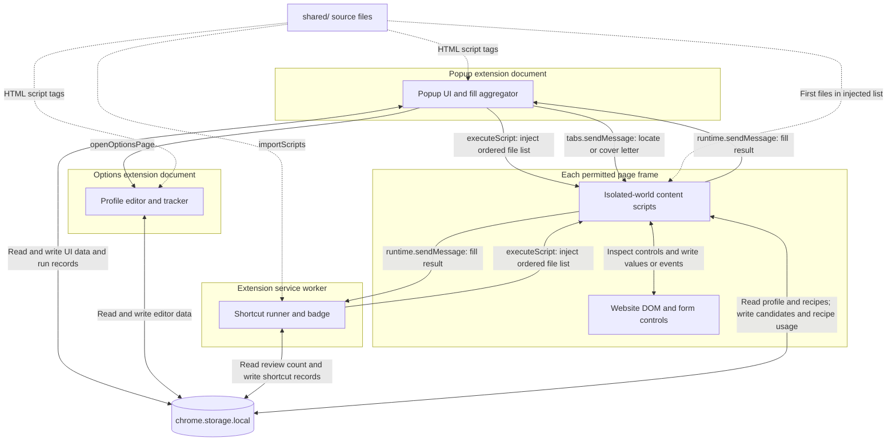
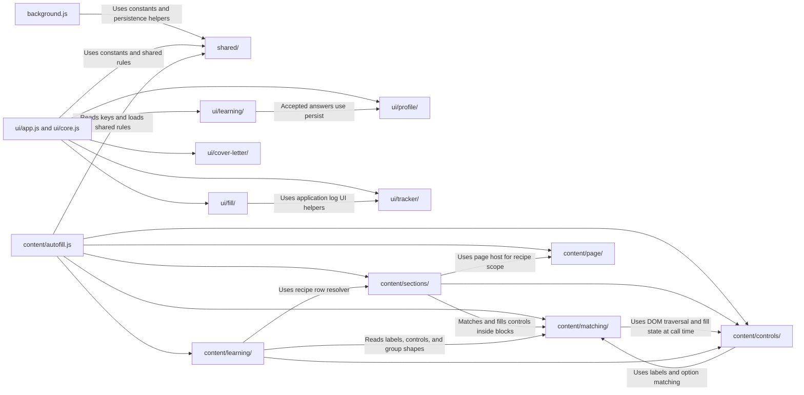
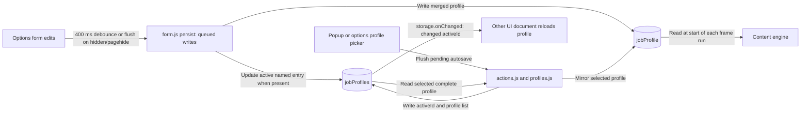
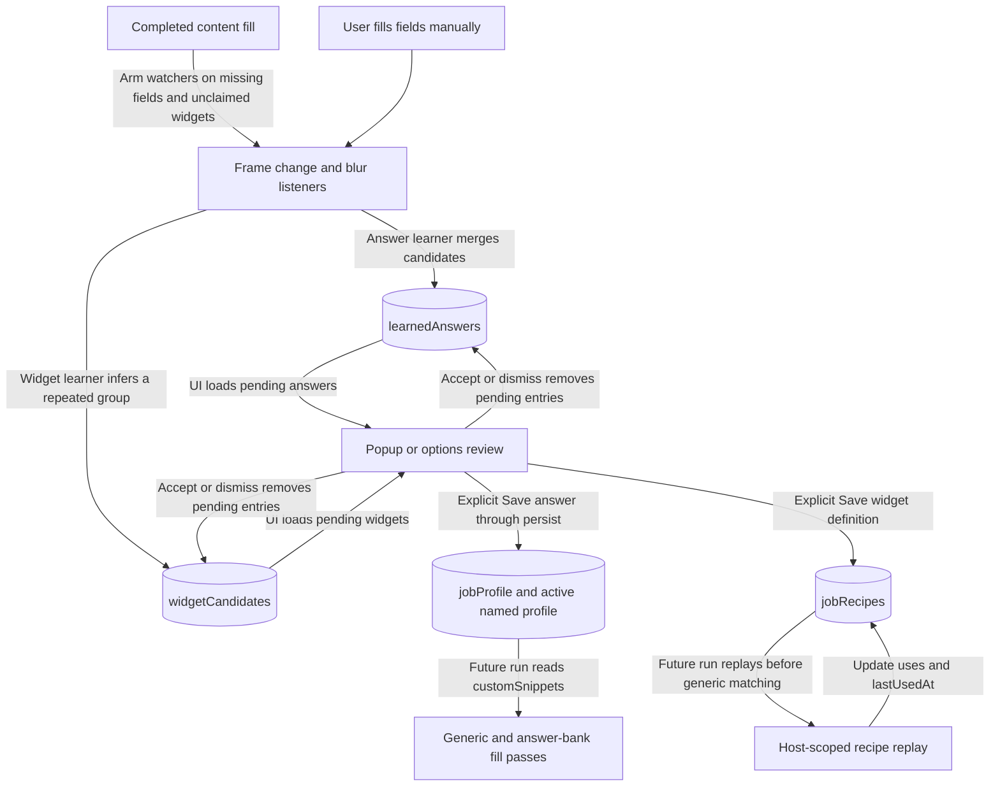
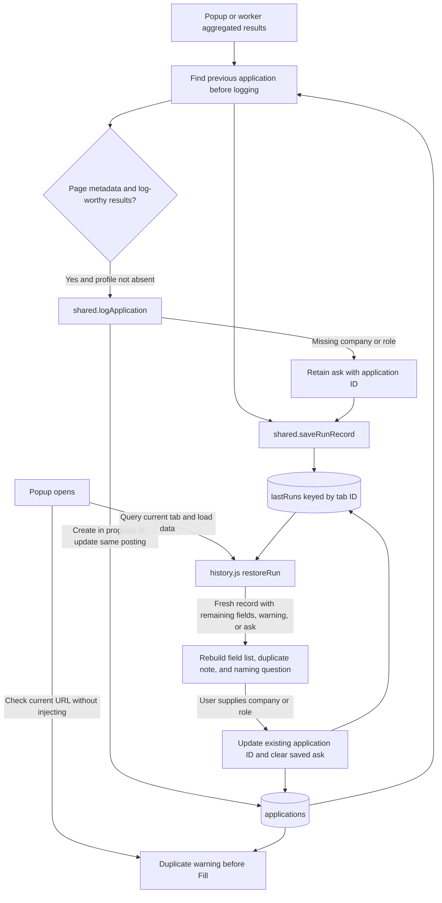

# Architecture

Private Job Autofill is a Chrome Manifest V3 extension built from plain JavaScript and HTML. Its popup and keyboard shortcut independently inject the same autofill engine into permitted page frames. Profiles, tracking records, and learning candidates live in `chrome.storage.local`; there is no application backend or outbound-request implementation in the inspected runtime code.

This document describes the current source, including implementation limitations. Start with the overview, then follow the fill sequences or data flows. Paths below link to the implementation.

## Execution contexts and entry points

The entry points are declared in [manifest.json](../manifest.json). No declarative `content_scripts` are registered: content scripts are injected on demand.

| Context | Entry point | Responsibility and lifetime |
| --- | --- | --- |
| Popup extension document | [popup.html](../popup.html), [ui/app.js](../ui/app.js) | Starts fills, selects profiles, reviews learning, shows remaining fields and duplicate warnings, composes cover letters. Its in-memory state disappears when it closes. |
| Options extension document | [options.html](../options.html), [ui/app.js](../ui/app.js) | Full profile editor, resume, templates, named profiles, application tracker, saved widgets, backup/restore/delete. Uses the same scripts as the popup, wiring controls only when their elements exist. |
| Extension service worker | [background.js](../background.js) | Handles `fill-active-form` (default Alt+Shift+F), aggregates shortcut results, records shortcut runs, and renders the toolbar badge. Has no document or DOM; its state is in memory. |
| Content-script isolated world, separately in each reached frame | [content/autofill.js](../content/autofill.js), loaded last | Reads the active profile, fills that frame, reports results, and arms learning listeners. JavaScript globals are separate from the website's globals; the DOM is shared. |
| Website documents | Active page and embedded frames | Own the actual form controls and site framework. Content scripts inspect and mutate these DOMs, including supported open shadow roots. Navigation destroys the injected document state. |

### Overview

Solid arrows describe runtime actions. Dotted arrows describe loading copies of shared source code, not messages or a shared in-memory service.



The worker processes result messages only while a shortcut run is active and only for its tab. Popup results feed its own active aggregator. The worker does not coordinate ordinary popup fills. Access comes from `activeTab`, the listed ATS host permissions, or optional `*://*/*` access explicitly requested from the popup; inaccessible frames can remain unfilled.

## Modules and loading order

These are classic scripts, not ES modules. UI files share one document scope; content helpers attach to `window.__JobAutofill` (`JA`). [shared/index.js](../shared/index.js) creates `JOB_AUTOFILL_SHARED`, and its sibling scripts extend it with `Object.assign`. Each execution context gets its own copy.



Arrows identify selected calls/dependencies, not a complete import graph. Mutual matching/control dependencies resolve through functions called after helpers load.

| Area | Responsibilities |
| --- | --- |
| [shared/](../shared/) | Storage keys, script list, limits, phone normalization, learning/widget/profile sanitizers, application identity, and the shared `logApplication` / `saveRunRecord` storage helpers. This is not exclusively pure code. |
| [ui/fill/](../ui/fill/) | Injection, result aggregation, remaining-field rendering/locating, permission offer, and restoring per-tab results. |
| [ui/profile/](../ui/profile/) | Form collection, queued profile writes, autosave, repeatable editor cards, resume bytes, named-profile actions, backup/restore/delete. |
| [ui/learning/](../ui/learning/) | Candidate review and explicit promotion to answer-bank entries or saved widget recipes. |
| [ui/tracker/](../ui/tracker/) | Application list, naming/status edits, duplicate lookups, CSV export, and the missing-company/role question. |
| [ui/cover-letter/](../ui/cover-letter/) | Template editing, placeholder substitution, preview/copy, and explicit type-into-page action. |
| [content/matching/](../content/matching/) | Field maps, labels/signals, option and polarity matching, field selection, and unfilled reports with field references. |
| [content/controls/](../content/controls/) | DOM state/traversal/events, setters, locating, native/custom selects, dates, radios, split phone controls, and resume attachment. |
| [content/sections/](../content/sections/) | Repeatable work/education blocks and replay of host-scoped saved widget definitions. |
| [content/learning/](../content/learning/) | Watches committed manual edits, reads repeated-group shapes, and stores answer/widget candidates. |
| [content/page/page-info.js](../content/page/page-info.js) | Extracts job metadata from the top document and provides the current frame's host for recipe matching. |

Both HTML pages load the same ordered list: `shared/index.js`, then shared `phone`, `learned`, `applications`, `widgets`, `profiles`; `ui/core.js`; profile `form`, `sections`, `resume`, `backup`, `profiles`, `actions`; learning `learned`, `widgets`; fill `aggregate`, `run`, `unfilled`, `history`; tracker `applications`, `job-ask`; cover-letter `letter`, `templates`; and finally `ui/app.js`. See the script tags in [popup.html](../popup.html) and [options.html](../options.html). Bootstrap waits for `DOMContentLoaded`, installs handlers, loads data, then restores the current tab's run and checks duplicates.

The worker loads the six shared files in that same shared-file order using `importScripts`. Injection uses the authoritative `contentScripts` array in [shared/index.js](../shared/index.js), in this exact order:

1. Shared: `index`, `phone`, `learned`, `applications`, `widgets`, `profiles`.
2. Matching: `field-map`, `field-signals`, `option-match`, `field-matcher`, `unfilled-report`.
3. Controls: `shadow-dom`, `dom-state`, `dom-events`, `dom-inject`, `locate`, `field-fill`, `combobox`, `dates`, `radios`, `phone`, `files`.
4. Page: `page-info`; sections: `repeatable`, `recipe-replay`.
5. Learning: `answers`, `widget-shape`, `widgets`.
6. `content/autofill.js`, which immediately starts the run.

Definitions can reference helpers loaded later, but those helpers must exist before the orchestrator calls them. The shared root must load before its extensions; recipe replay must load before widget learning uses its resolver; the orchestrator and UI bootstrap must load last. Reinjection reuses guarded message/learning listeners instead of stacking them.

## Runtime message contract

| Message | Sender and transport | Receiver and behavior |
| --- | --- | --- |
| `JOB_AUTOFILL_RESULT` | Each content frame via `chrome.runtime.sendMessage` | Popup [onAutofillResult](../ui/fill/run.js) and worker listener in [background.js](../background.js). Status is `ok`, `busy`, `empty`, or `error`. Successful payloads include counts, unfilled fields, section issues, frame URL, iframe count, and top-frame job metadata. Recipients aggregate only while their run is active. |
| `JOB_AUTOFILL_LOCATE` | [ui/fill/unfilled.js](../ui/fill/unfilled.js), via `chrome.tabs.sendMessage` to the recorded frame when available | Listener in [content/autofill.js](../content/autofill.js) resolves `ref`, scrolls, and highlights. It sends no explicit success response. |
| `JOB_AUTOFILL_COVER_LETTER` | [ui/cover-letter/letter.js](../ui/cover-letter/letter.js), via `chrome.tabs.sendMessage`, top frame first, then tab-wide fallback | Content listener fills a matching letter field asynchronously and responds `{ ok: boolean }`. Ordinary fills do not type the composed letter. |

`chrome.storage.onChanged` is a separate event mechanism: the worker watches `learnedAnswers` for badge refresh; UI pages watch active-profile changes/removal; learning watchers stop collecting after `jobProfile` is removed. Candidate lists are loaded on UI bootstrap, not continuously refreshed by a general candidate-change subscription.

## Fill execution

### Popup Fill

Sources: [ui/fill/run.js](../ui/fill/run.js), [aggregate.js](../ui/fill/aggregate.js), [history.js](../ui/fill/history.js).

```mermaid
sequenceDiagram
    actor User
    participant P as Popup runner and aggregator
    participant API as Chrome scripting API
    participant C as Content engine in reached frames
    participant S as Local storage
    User->>P: Click Fill Application
    opt Replace history checked
        P->>User: Confirm deletion for this run
        Note over User,P: Cancellation returns before injection
    end
    P->>P: Start aggregation and 15-second deadline; query active tab
    Note over P: Missing tab or query failure cancels the run
    opt Deletion confirmed
        P->>API: Set one-use approval in target frames
    end
    P->>API: Inject ordered files with allFrames
    Note over API: Retry without matchOriginAsFallback if unsupported
    alt All-frame injection rejects
        P->>API: Retry files in top frame only
        Note over P,API: If retry fails, cancel and show cannot-run warning
    end
    API->>C: Evaluate scripts in permitted frames
    API-->>P: Injection results establish expected frame count
    Note over P,C: Messages may arrive before the expected count is known
    C->>S: Read jobProfile and saved recipes
    C->>C: Run shared fill pipeline or report busy, empty, or error
    C-->>P: JOB_AUTOFILL_RESULT from each reporting frame
    P->>P: Add sender frameId to field references and aggregate
    Note over P: All statuses count as replies; busy is not a fill error
    alt Every expected frame reports
        P->>P: Finish after 250 ms grace
    else Deadline expires
        P->>P: Finish available results and show known reply shortfall
    end
    P->>P: Render status, remaining fields, duplicate warning
    opt Unreachable-frame predicate is true
        P->>P: Offer optional host access if not already granted
    end
    opt Top-frame metadata and log-worthy scan or fill
        P->>S: logApplication; create or update in-progress record
        P->>P: Ask for missing company or role
    end
    P->>S: saveRunRecord for active tab
    Note over P,API: Finally, clear any remaining one-use deletion approval
```

The permission offer uses `iframes > 0`, fewer replies than `1 + iframes`, and zero filled fields; the iframe counter filters for form-capable frames. Granting access asks the user to press Fill again. Popup cleanup of deletion approval runs in the injection function's `finally`, independently of asynchronous result completion. Profile absence suppresses logging. A run is log-worthy when page metadata exists and at least one field was scanned/filled, a resume attached, or a drop zone flagged.

### Keyboard shortcut

Source: [background.js](../background.js). This path has its own aggregation and no top-frame-only fallback after all-frame injection fails.

```mermaid
sequenceDiagram
    actor User
    participant W as Background service worker
    participant API as Chrome scripting API
    participant C as Content engine in reached frames
    participant S as Local storage
    User->>W: fill-active-form command
    W->>W: Ignore if shortcut run active; query active tab
    Note over W: No tab or non-HTTP URL shows warning; query failure returns
    W->>W: Create run and show filling badge
    W->>API: Inject ordered files with allFrames
    Note over API: Retry without matchOriginAsFallback if unsupported
    alt Injection fails
        W->>W: Clear run and show warning badge
    else Injection succeeds
        API->>C: Evaluate content engine in reached frames
        API-->>W: Establish expected frame count
        W->>W: Start 15-second completion timer
        C->>S: Read active profile and recipes
        C->>C: Run shared pipeline or return busy, empty, or error
        C-->>W: JOB_AUTOFILL_RESULT
        W->>W: Aggregate replies from run tab and remember top-frame page
        alt Every expected frame reports
            W->>W: Finish immediately
        else Completion timer expires
            W->>W: Finish partial results
        end
        W->>W: Show filled-count badge or zero
        opt Top-frame report includes page metadata
            W->>S: Read previous applications for duplicate finding
            opt Log-worthy results and no empty-profile report
                W->>S: logApplication; retain missing-name ask if needed
            end
            W->>S: saveRunRecord for shortcut tab
        end
    end
```

The worker counts `busy` and `error` messages toward completion. It tracks error counts but its final badge is based on filled count, without the popup's detailed timeout/error notes. Shortcut persistence is best-effort and starts after the badge update. The shortcut does not set one-use deletion approval, even if the profile's `replaceHistory` preference is true. Outside a transient result, the badge shows the pending answer-candidate count, not the widget-candidate count.

### Shared content pipeline

Source: [content/autofill.js](../content/autofill.js). Each frame runs independently.

1. Consume one-use deletion approval and reject overlapping work with `busy`. Read `jobProfile`; report `error` for unavailable storage or `empty` for absent/non-object profile. Derive full name when needed.
2. Replay approved widgets first, scoped by host and matching anchors. A run-wide `used` set keeps later passes from claiming those fields.
3. Fill split phone controls, standard text fields, native selects, date select pairs, profile radios, answer-bank radios, then answer-bank text/select fields. If neither this pass nor widget replay filled anything, watch DOM mutations for up to two seconds and retry the generic pass.
4. Fill custom comboboxes, then repeatable work/education sections. Trim surplus blocks only with the consumed deletion approval.
5. Attach the stored resume or flag a resume zone; preserve existing attachments and collect acknowledgement counts.
6. Reveal options for up to five unanswered required comboboxes. Collect missing fields and scan/iframe counts; get job metadata only in the top frame; send the result. The reported unfilled list is capped at 40 entries per frame.
7. Arm manual-answer and widget-learning watchers. Release the active-run guard in `finally`; unexpected errors report `error`.

## Data ownership and persistence

All seven keys are defined in [shared/index.js](../shared/index.js). All are local storage, so their stored values survive popup closure and browser sessions until overwritten or removed. This does not make their references to a particular tab or DOM valid after navigation/restart.

| Actual key | Shape and purpose | Normal readers | Normal writers and retention |
| --- | --- | --- | --- |
| `jobProfile` | Active profile object, including resume, snippets, work/education, templates, and preference | UI; content fill and learning | UI profile persistence/switching and accepted-answer review. No automatic expiry. |
| `jobProfiles` | `{ activeId, items: [{ id, name, profile }] }` | UI | UI profile save/actions and legacy adoption; up to 8 profiles, each with its own resume. |
| `learnedAnswers` | `{ candidates, skipped }`, pending answers and ambiguity notes | UI review; content learning; worker badge | Content learner merges observations; UI accepts/dismisses. At most 20 candidates; no time expiry. |
| `widgetCandidates` | `{ candidates, skipped }`, unapproved widget definitions | UI review; content widget learner | Content learner and UI review/dismissal; up to 10 candidates, no time expiry. |
| `jobRecipes` | `{ items }`, approved host-scoped definitions with rows and usage metadata | Content replay/widget learner; UI | UI approval/rename/delete; content replay updates usage metadata. Up to 20 recipes; no time expiry. |
| `applications` | `{ items }`, posting identity, timestamps, visit count, status | UI tracker; worker; shared log helper | Popup/worker call shared `logApplication`; UI edits names/statuses and deletes rows. Up to 500 entries. |
| `lastRuns` | Object keyed by tab ID; records contain `at`, `results`, `page`, `duplicate`, `ask` | UI restore and cover-letter lookup; shared run helper | Popup/worker call shared `saveRunRecord`; UI clears answered asks. New saves prune to 5 tabs and 6 hours; UI restore ignores expired records. No scheduled expiry deletion. |

The backup/restore UI is an additional reader/writer for profile, named profiles, recipes, applications, and learned answers. Backups exclude `lastRuns` and `widgetCandidates`. Restore only replaces sections present in the file. Delete-all removes every key above. See [ui/profile/backup.js](../ui/profile/backup.js).

### Profiles: edit, select, fill



[form.js](../ui/profile/form.js) merges only controls present on the current page over its cached profile, then serializes writes through `profileWrites`. The popup persists its replace-history preference; options autosaves the full editor. [actions.js](../ui/profile/actions.js) flushes before switching and reloads other UI documents when `activeId` changes. [profiles.js](../ui/profile/profiles.js) mirrors the active named entry into `jobProfile`, so the content engine never needs to choose a named profile itself.

### Learning: observation, review, reuse



Candidates are already persisted locally before review; Save approves reuse. Pending candidates never directly fill forms. [answers.js](../content/learning/answers.js) tracks fields left by the fill, avoids already-covered questions, and records conflicting observations as skipped. [widgets.js](../content/learning/widgets.js) ignores controls claimed by autofill, reads group structure through [widget-shape.js](../content/learning/widget-shape.js), and can bind learned values to profile keys. Watchers are reused across fills in the same document.

The [answer review](../ui/learning/learned.js) appends accepted `{ key, value }` entries to `customSnippets` using profile persistence. The [widget review](../ui/learning/widgets.js) promotes approved candidates to recipes. Popup widget offers are filtered to the current host; options can review all hosts. Recipes are global stored definitions scoped by host, not separate lists per named profile; their bindings can use the active profile during [replay](../content/sections/recipe-replay.js).

### Application tracking and reopening the popup



The save arrow represents the independent result-recording step; it also runs without an eligible application in the popup path. The worker requires a top-frame page report before saving either tracking or run data.

[shared/applications.js](../shared/applications.js) owns identity and persistence rules. Canonical URL matching preserves job-identifying query parameters and removes known trackers. Company/role matches can produce a possible-repeat warning without merging different known posting URLs. Repeated fills within five minutes do not increment the visit count. New rows start `in progress`; submission status changes are explicit UI actions.

[history.js](../ui/fill/history.js) restores results by tab ID and age, while [job-ask.js](../ui/tracker/job-ask.js) edits the existing row and clears its saved question. Remaining-field entries include labels and, where available, DOM references and frame IDs; saved results also include counts and job metadata. These records are richer than just field labels.

## Verification and limitations

The relationships above were checked against the manifest, both HTML script lists, shared key/script definitions, worker handlers, content orchestrator, and UI fill/profile/learning/tracker implementations. Source behavior takes precedence over older comments that mention superseded filenames or describe run records as labels only. No applicable `AGENTS.md` was found in the repository or checked workspace ancestors.

Important limits visible in the implementation:

- **Popup lifetime:** popup aggregation and final persistence belong to the popup document. Closing it before completion can lose its final run/log write even though content scripts continue. The worker only aggregates its own shortcut runs.
- **Worker lifetime:** shortcut state and completion timers are in memory; no recovery of an interrupted worker run is implemented.
- **Reply identity:** results carry no run ID, and completion counts replies rather than unique sender frames. Overlapping popup/shortcut runs or delayed replies can mix same-tab results; per-frame busy guards and the worker's shortcut guard reduce overlap but do not provide cross-context coordination.
- **Storage concurrency:** profile writes are queued inside one UI document. Whole-record read/modify/write operations across documents, frames, or the worker have no global transaction or lock, so concurrent writes can overwrite one another.
- **Stale references:** restored runs are checked by tab ID and age, not current URL or document identity. Browser-session persistence does not guarantee that tab IDs or DOM references still refer to the original page.
- **Cover-letter lookup mismatch:** `pageForTab()` in [letter.js](../ui/cover-letter/letter.js) reads `record.results.page`. Shortcut records put metadata in `record.page`, without adding it to `results`; this lookup can fall back to tab title after a shortcut run despite saved page metadata.
- **Browser-dependent behavior:** actual host access, iframe injection, framework-controlled inputs, uploads, and MV3 worker suspension need browser verification. Source inspection alone does not establish success on every ATS.

No Mermaid renderer or parser was available in the project's installed tooling during this review. Diagram fences and local source links were checked, but Mermaid parsing and visual rendering were not verified. Application behavior was not changed.
